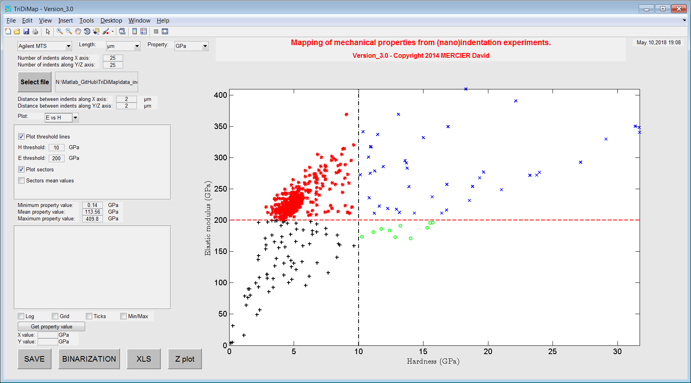
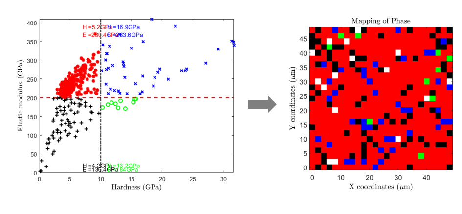
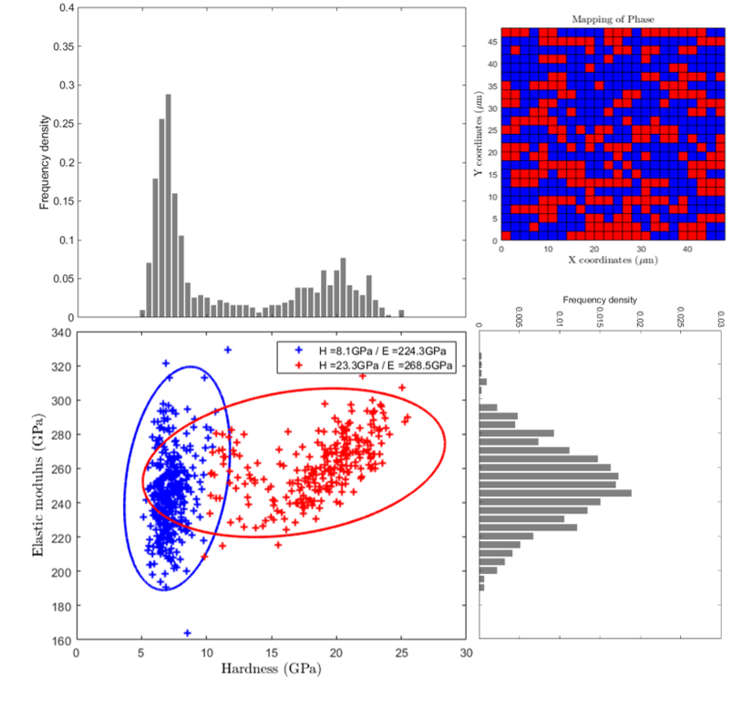
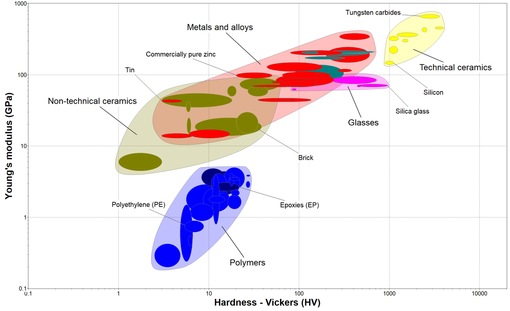

Elastic modulus vs Hardness plot
=================================

.. include:: includes.rst

Another way to visualize the distribution of mechanical property results is to plot, for example,
the elastic modulus (E) values against the hardness (H) values. Such a plot can reveal
families of points and the definition of "sectors" or "bubbles",
each one corresponding to a single phase (e.g. soft matrix vs hard and stiff particles).

The correlation between elastic and plastic properties has been extensively studied in the literature
[#Gent_1958]_, [#Bao_2004]_, [#Oyen_2006]_ and [#Labonte_2017]_.

.. note::
    Elastic modulus is an intrinsic material property and hardness is an engineering property, which can be related to yield strength for some materials.

Raw or processed E-H data
########################

The **E-H data** selector beside the clustering selector offers
**raw measurements** (default) and **processed maps**. Changing to
**E vs H** no longer forces a different map-rendering style. Existing
Remove NaN, interpolation and smoothing checkbox values and factors are
retained when switching between map and E-H views.

Raw analysis uses the thresholded, cropped measured E/H pairs, without
filling, interpolation or smoothing. Processed analysis applies the current
**Remove NaN pixels** setting separately to both E and H, crops both maps,
then applies the same interpolation and smoothing pipeline used for map
display. Configure those settings in an E or H map before switching to E-H.
Interpolation/smoothing still require Remove NaN, as in the map workflow.
Normalization, translation and the smoothing error map are display options
and are not substituted for mechanical E/H values in GPa.

The selected dataset is used consistently for the E-H scatter, sectors,
GMM/ML fitting, phase maps and joint PDFs. Processing is opt-in and never
overwrites the measured arrays. Processed-mode counts and phase fractions
describe map pixels, including filled/interpolated values, rather than
additional independently measured indents. A warning makes that distinction
explicit. Interpolated spatial maps and ML CSV exports use the refined grid
spacing and retain the physical extent and crop offset; processed export
headers identify the data source. Irregular XY data supports raw input only.

E-H map sectorization
############################################

As a first analysis of such a plot, sectors can be defined by giving an average value of elastic modulus and
an average of hardness value, separating respectively by an horizontal line
and a vertical line the different bubbles of points.
Each sector is shown in a unique color.

Finally, average mechanical property values are shown directly on the graph for each sector,
and a 4 color-coded map corresponding to this plot can be generated (see 2nd figure).

   
   *Example of sectorized elastic modulus vs hardness plot*
   

   
   *Sectorized elastic modulus vs hardness plot with mean values and corresponding mechanical map*

Automated cluster analysis (K-Means, Gaussian Mixture, ...)
############################################

Cluster analysis, or clustering, is an unsupervised machine-learning technique used to group similar data points based on inherent patterns or features. Common clustering algorithms include K-Means and Gaussian Mixture Models (GMMs), both of which are widely applied to nanoindentation datasets. A recent comparative study explores the performance of clustering methods on nanoindentation mapping data [#Alizade_2025]_. These techniques are usually applied to E-H plots, but an additional property, such as E/H or kernel-averaged mechanical mismatch (KAMM), can also support the clustering analysis [#Mercier_2025]_, [#Mercier_2026]_.

K-Means models
+++++++++++++++++++++++++++
K-Means clustering is frequently used for the analysis of nanoindentation data [#Koumoulos_2019]_, [#Konstantopoulos_2020]_, 
[#Alhamdani_2022]_, [#Jentner_2023]_. As explained in [#Koumoulos_2019]_, the K-Means algorithm aims to partition n observations into k clusters, where each observation belongs to the cluster with the nearest mean—this mean serving as a prototype of the cluster. The number of clusters k is predefined, and each point is assigned exclusively to one cluster.

Initially, k cluster centroids are randomly initialized. Each data point is then assigned to the cluster whose centroid is closest in terms of Euclidean distance. After all points are assigned, the algorithm recalculates the centroids as the mean of the points in each cluster. This process—assignment followed by centroid update—is repeated iteratively until convergence. A concise description of this method is also available in the |matlab| documentation [#Matlab_KM]_.

A possible |matlab| third party code, which could be used to define clusters with K-Means model is: https://www.mathworks.com/matlabcentral/fileexchange/24616-kmeans-clustering?s_tid=mwa_osa_a

Gaussian mixture models
+++++++++++++++++++++++++++

GMMs are also used for clustering nanoindentation data [#Wilson_2018]_, [#Chen_2021]_.
This method is described in the |matlab| documentation [#Matlab_GMM]_, [#Matlab_cluster]_, and [#Matlab_clustering]_, as well as in the literature [#Fraley_1998]_.

This method can distinguish contributions from two or three phases (especially in the case of a soft metallic matrix with hard ceramic particles)
in the cloud of experimental points [#Hu_2005]_.
Average mechanical property values can also be extracted using this method,
and each phase can be shown with a separate color on the map.

The influence of indentation size and spacing on statistical phase analysis has also been studied using high-speed indentation mapping and clustering [#Besharatloo_2021]_.

The |matlab| third-party code used to define clusters with GMMs is: `GMMClustering.m <https://github.com/DavidMercier/TriDiMap/blob/master/third_party_codes/GMMClustering/GMMClustering.m>`_

The GUI's **Gaussian Mixture Model** option supports two or more phases. It
uses a deterministic multi-start initialization and regularized EM fitting in
base MATLAB; phase labels are ordered by increasing mean hardness. Counts
above three are supported with additional plot colors, but produce a MATLAB
warning to encourage checking that the chosen phase count is justified by
the data. This legacy option is distinct from the **ML-assisted clustering**
GMM, which requires the Statistics and Machine Learning Toolbox.

   
   *Elastic modulus vs hardness plot with clusters of points obtained with GMM*

ISOMAP-assisted clustering
+++++++++++++++++++++++++

The **ML-assisted clustering** option also offers
**ISOMAP + K-means (base MATLAB)**. It embeds standardized mechanical
and optional KAMM features using neighbourhood geodesic distances, then
clusters the two-dimensional embedding. The neighbour count is selectable;
**ISOMAP embedding**, E-H and spatial phase-map views share the fitted
labels. See :doc:`kamm` for usage, Python support and limitations.
This is an opt-in ISOMAP workflow, not the complete spatial/hierarchical
procedure described by Bernachy-Barbe (2019), discussed in :doc:`kamm`.

Cluster envelopes
+++++++++++++++++++++++++++

In the E-H plot, choose **Gaussian Mixture Model** and use the envelope selector
below the phase count. **Convex hull / legend** outlines each cluster using
MATLAB's ``convhull``, in the same color as its points. **Ellipse fit / legend**
retains the previous ellipse-fitting display; **No envelopes / legend** hides
both the envelopes and the phase legend (the default).
The legend reports the mean hardness and elastic modulus of each cluster.
Changing the envelope type does not rerun clustering or change cluster labels.

For **ML-assisted clustering**, the same selector appears in the upper
E-H options panel for **E-H clusters** and **ISOMAP embedding** views.
Choose **Convex hull / phase legend** or **Ellipse fit / phase legend**.
The default **No envelopes / phase legend** preserves the ML phase legend.
Envelopes use the assigned points in the displayed coordinates and match
each phase's color, including when there are more than three phases.
They are display-only: changing them does not refit K-means, GMM or ISOMAP.
The selector is hidden for spatial maps and 3D views.

A convex hull encloses every finite point in the cluster, including outliers;
it is not a confidence region. Duplicate points do not change the outline.
Two-point and collinear clusters are represented by a line segment; a singleton
remains its plotted point. Nonfinite coordinates are excluded with a warning.
Ellipse fits need at least five distinct, nondegenerate points; an
unidentifiable fit is omitted with an explicit warning, leaving its points
and phase assignments unchanged. Ellipses are the existing geometric fit,
not a statistical confidence region.

Joint probability density of each phase
++++++++++++++++++++++++++++++++++++++++++

Select **E vs H**, choose **Plot sectors** or **Gaussian Mixture Model**, then
choose **Joint phase PDFs (3D)** in the lower E-H options panel. The default
**E-H points** view retains the scatter plot and cluster-envelope options.
With **No clusters**, the density view treats the measurements as one phase.
The spatial **Plot map with sectors** option is disabled while viewing densities.

Each translucent surface is a correlated bivariate Gaussian fitted to the
finite selected hardness/modulus pairs assigned to that phase (raw by default,
or processed when explicitly selected). Its mean and
maximum-likelihood covariance are estimated from those pairs, rather than from
rounded legends or resampled map pixels. For GMM clusters these are estimates
from the hard assignments, not the soft-assignment EM component parameters.
Changing this view reuses the current cluster labels without rerunning GMM.

The plotted contribution is ``w_k * N([H,E]; mean_k, covariance_k)``, where
``w_k`` is the phase's fraction of assigned finite pairs. Its integral is
``w_k``, not one; summing all phase contributions gives the mixture density.
This is the standard multivariate-normal density described by MATLAB's
`mvnpdf <https://www.mathworks.com/help/stats/mvnpdf.html>`_, evaluated with
base MATLAB linear algebra; no FieldTrip installation is required.

Density has reciprocal squared property
units (for example GPa^-2). Each surface spans four marginal standard
deviations either side of its mean, and the base ellipses are one-, two- and
three-standard-deviation isodensity contours. Gaussian tails may extend below
zero; the estimate is not a truncated distribution.

The plot controls also apply to this view:

* **Log** uses logarithmic H and E axes, matching the E-H scatter view.
  Nonpositive mesh coordinates are hidden only for display; the Gaussian fit,
  phase fractions and density values are unchanged and are not renormalized.
  A phase with no positive H-E mesh is omitted from the logarithmic display
  with a warning. The density (vertical) axis remains linear.
* **Grid** toggles grid lines on all three axes.
* **Ticks** toggles minor ticks on all three axes.
* **Min/Max** marks and labels the lowest and highest displayed density of each
  phase, including for irregular-XY imports. The minimum refers to the displayed
  finite mesh, not a global minimum of the unbounded Gaussian.

Nonfinite or unassigned pairs are excluded with a warning. A phase needs at
least three non-collinear finite pairs; undersized or singular phases are
omitted with a warning rather than assigned an artificial width. Their
fractions are not redistributed to other phases. If no density can be
estimated, an error dialog is shown. Measurements and phase labels are not
modified. **SAVE** and **Colormap > Grayscale (all plots)** also apply to this view.

Determination of the number of clusters
+++++++++++++++++++++++++++

The optimal number of clusters (k) can be determined using the elbow method.
This method looks at the total within-cluster sum of square (WSS) as a function of the number of clusters.
Choose a number of clusters such that adding another cluster does not substantially reduce the total WSS.

The method can be applied in four steps:

1. Run a clustering algorithm (e.g., K-Means or GMM) for different values of k.
2. For example, vary k from 1 to 5 and calculate the total WSS for each value.
3. Plot the total WSS against the number of clusters, k.
4. Choose the bend (or "knee") in the plot as an estimate of the appropriate number of clusters.

Note that the elbow method can be ambiguous. Alternatives include the average silhouette method and the gap statistic method.

KAMM analysis (Kernel-Averaged Mechanical Mismatch)
############################################

An implemented **ML-assisted clustering** option is now available in the
E-H GUI. See :doc:`kamm` for the controls, exact neighbourhood formulas,
limitations and the independent license-free Python notebook.

A recent development in nanoindentation data analysis is the Kernel-Averaged Mechanical Mismatch (KAMM) descriptor, which can support clustering and phase identification in mechanical-property maps [#Mercier_2026]_.
Analyses based solely on elastic modulus (E) and hardness (H) may struggle to distinguish phases when mechanical contrast is low or diffuse interphase regions are present. This can be a challenge in multiphase materials such as composites, alloys, and cementitious systems [#Mercier_2026]_.
KAMM introduces a neighborhood-aware metric to quantify local mechanical heterogeneity. Rather than considering each indentation independently, it evaluates the mismatch between a data point and its neighbors in (E, H) space, capturing spatial correlations and mechanical gradients in the dataset [#Mercier_2026]_.
By incorporating KAMM as an additional feature, clustering can be performed in an augmented three-dimensional space (E, H, KAMM). The study reports improved:

* Phase separability
* Detection of interphase regions
* Robustness to experimental noise

This method may be useful for datasets exhibiting:

* Low contrast between phases
* Gradual transitions (graded interfaces)
* Complex or diffuse morphologies

The framework also uses synthetic benchmarks with controlled complexity (e.g., curved boundaries, diffuse phases, and tunable contrast) to validate clustering approaches [#Mercier_2026]_. KAMM-enhanced clustering may support downstream applications such as:

* Generation of representative volume elements (RVEs)
* Extraction of phase-specific mechanical properties
* Integration into ICME (Integrated Computational Materials Engineering) workflows

This approach can be combined with standard clustering methods (K-Means, GMM, Agglomerative clustering, etc.), providing a flexible and powerful extension to existing E–H map analysis techniques.

Next steps: Ashby map or self-organized maps
############################################

After analytical, sectorization, or clustering approaches, the next step could be to use nanoindentation outputs
(phase mechanical properties in the case of a composite, an alloy...) for material selection, material design, material discovery....

One common strategy for material selection is to use a conventional Ashby map [#Ashby_2005]_.
The following figure shows a typical Ashby map with material families (envelopes around different materials), created using CES Selector 2018 software [#CES_Selector]_.
At some point, it is possible to add material reference (bulk, homogeneous, monophasic, ...) values on the E-H map,
in order to compare experimental data with data from the literature.

   
   *Typical Ashby map of elastic modulus vs Vickers hardness, obtained using CES Selector software*
   
For material design or discovery, one option is to use self-organizing maps (SOMs)
[#Qian_2019]_ in the framework of material informatics. Here an example for Atomic Force Microscopy (AFM) technique [#Weber_2023]_.
	
References
############################################

.. [#Alhamdani_2022] `Alhamdani S.G. et al., "Cluster-Based Colormap of Nanoindentation Using Machine Learning" (2022). <https://doi.org/10.46254/AN12.20220621>`_
.. [#Alizade_2025] `Alizade M. et al., "A Comparative Study of Clustering Methods for Nanoindentation Mapping Data" (2025). <https://doi.org/10.1007/s40192-024-00349-3>`_
.. [#Ashby_2005] Ashby M.F., "Materials Selection in Mechanical Design" (2005), ISBN 978-0-7506-6168-3.
.. [#Bao_2004] `Bao Y.W. et al., "Investigation of the relationship between elastic modulus and hardness based on depth-sensing indentation measurements" (2004). <https://doi.org/110.1016/j.actamat.2004.08.002>`_
.. [#Besharatloo_2021] `Besharatloo H. and Wheeler J.M., "Influence of indentation size and spacing on statistical phase analysis via high‑speed nanoindentation mapping of metal alloys" (2021). <https://doi.org/10.1557/s43578-021-00214-5>`_
.. [#CES_Selector] `CES Selector 2018 <https://www.grantadesign.com/>`_
.. [#Chen_2021] `Chen X. et al., "Clustering analysis of grid nanoindentation data for cementitious materials (2021). <https://link.springer.com/article/10.1007/s10853-021-05848-8>`_
.. [#Fraley_1998] `Fraley C. and Raftery A.E., "How Many Clusters? Which Clustering Method? Answers Via Model-Based Cluster Analysis" (1998). <https://doi.org/10.1093/comjnl/41.8.578>`_
.. [#Gent_1958] `Gent A.N., "On the Relation between Indentation Hardness and Young's Modulus." (1958). <https://doi.org/10.5254/1.3542351>`_
.. [#Hu_2005] `Hu C., "Nanoindentation as a tool to measure and map mechanical properties of hardened cement pastes" (2005). <https://doi.org/10.1557/mrc.2015.3>`_
.. [#Jentner_2023] `Jentner R.M. et al., "Unsupervised clustering of nanoindentation data for microstructural reconstruction: Challenges in phase discrimination" (2023). <https://doi.org/10.1016/j.mtla.2023.101750>`_
.. [#Konstantopoulos_2020] `Konstantopoulos G. et al., "Classification of mechanism of reinforcement in the fiber-matrix interface: Application of Machine Learning on nanoindentation data" (2020). <https://doi.org/10.1016/j.matdes.2020.108705>`_
.. [#Koumoulos_2019] `Koumoulous E.P. et al., "Constituents Phase Reconstruction through Applied Machine Learning in Nanoindentation Mapping Data of Mortar Surface" (2019). <https://doi.org/10.3390/jcs3030063>`_
.. [#Labonte_2017] `Labonte D. et al., "On the relationship between indenation hardness and modulus, and the damage resistance of biological materials" (2017). <https://doi.org/10.1016/j.actbio.2017.05.034>`_
.. [#Matlab_GMM] `Mathworks - Gaussian Mixture Models <https://fr.mathworks.com/help/stats/gaussian-mixture-models-1.html>`_
.. [#Matlab_KM] `Mathworks - K-Means Models <https://www.mathworks.com/help/stats/kmeans.html>`_
.. [#Matlab_cluster] `Mathworks - Cluster <https://fr.mathworks.com/help/stats/gmdistribution.cluster.html>`_
.. [#Matlab_clustering] `Mathworks - Cluster Using Gaussian Mixture Models <https://fr.mathworks.com/help/stats/clustering-using-gaussian-mixture-models.html>`_
.. [#Mercier_2025] `Mercier D. and El Gharoussi Y., "Unsupervised Machine Learning for Nanoindentation Mapping Analysis and Microstructural Correlation" (2025). <http://dx.doi.org/10.13140/RG.2.2.29301.49125>`_
.. [#Mercier_2026] `Mercier D. and El Gharoussi Y., "Enhancing Phase Clustering in Nanomechanical Property Maps of Multiphase Materials Using Kernel-Averaged Mechanical Mismatch" (2026). <https://arxiv.org/abs/2603.02090>`_
.. [#Oyen_2006] `Oyen M.L., "Nanoindentation hardness of mineralized tissues" (2006). <https://doi.org/10.1016/j.jbiomech.2005.09.011>`_
.. [#Qian_2019] `Qian J., "Introducing self-organized maps (SOM) as a visualization tool for materials research and education" (2019). <https://doi.org/10.1016/j.rinma.2019.100020>`_
.. [#Weber_2023] `Weber A., "Application of self-organizing maps to AFM-based viscoelastic characterization of breast cancer cell mechanics" (2023). <https://doi.org/10.1038/s41598-023-30156-3>`_
.. [#Wilson_2018] `Wilson W. et al., "Automated coupling of NanoIndentation and Quantitative EnergyDispersive Spectroscopy (NI-QEDS): A comprehensive method to disclose the micro-chemo-mechanical properties of cement pastes" (2018). <https://doi.org/10.1016/j.cemconres.2017.08.016>`_
