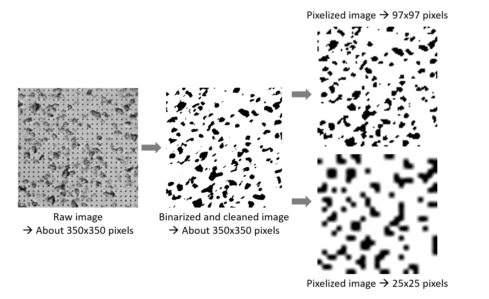
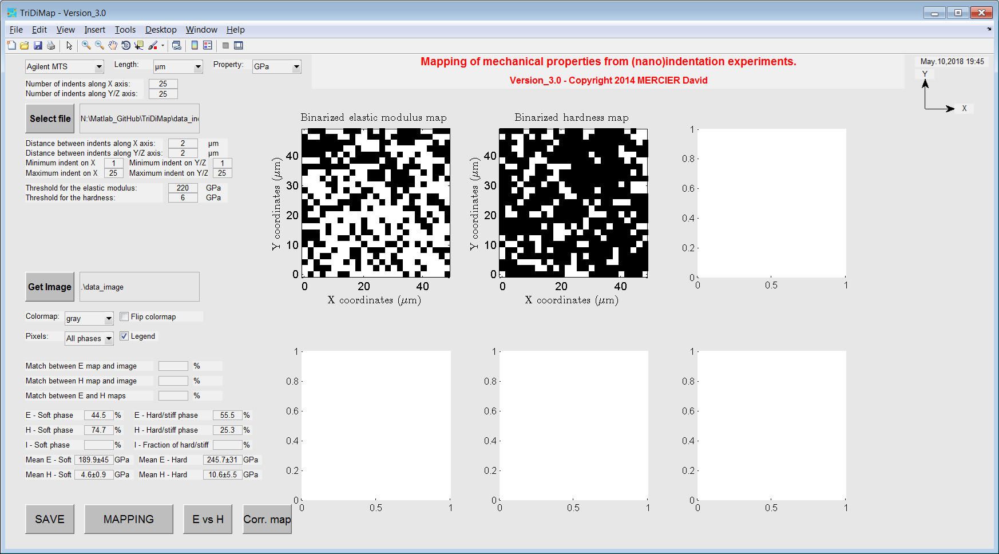
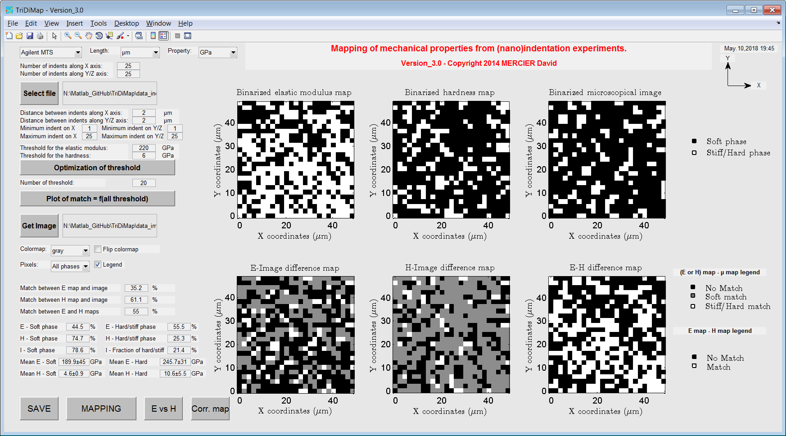
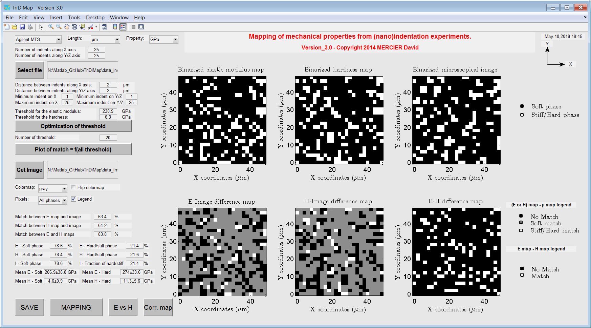
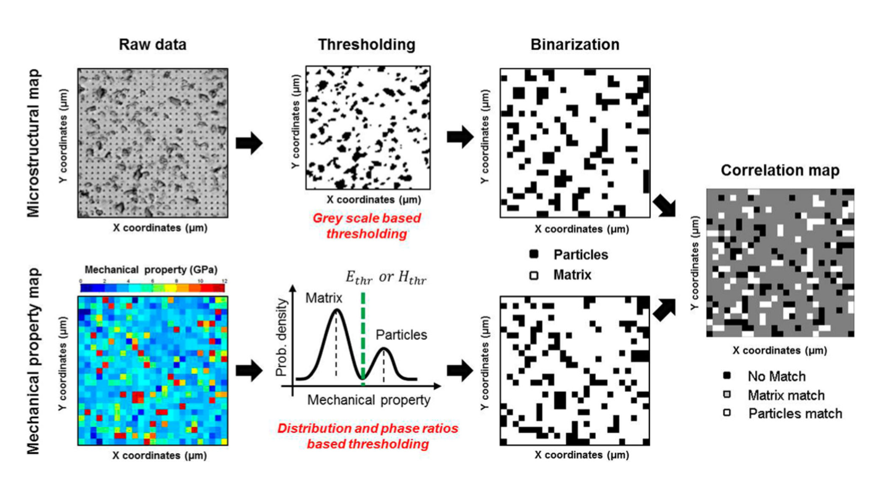
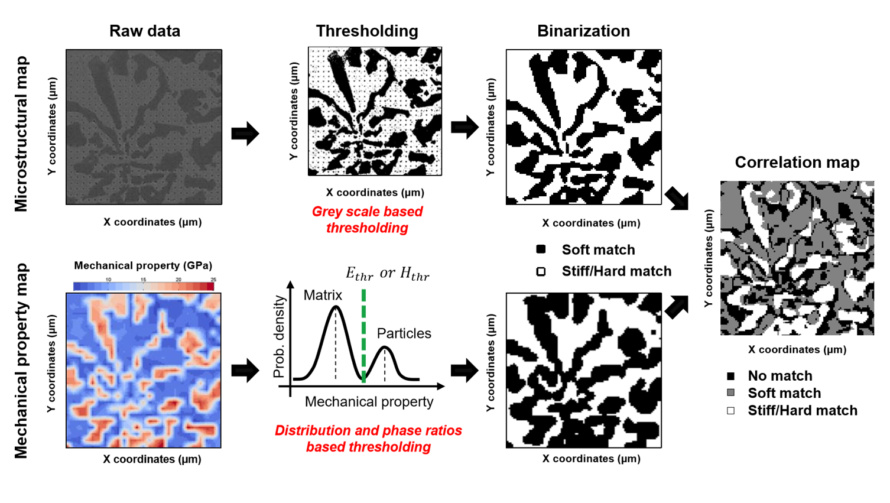
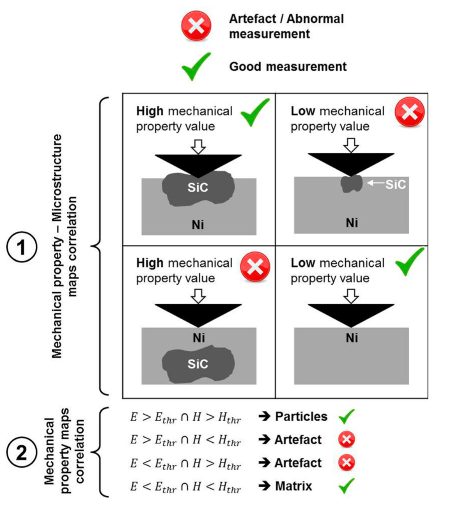
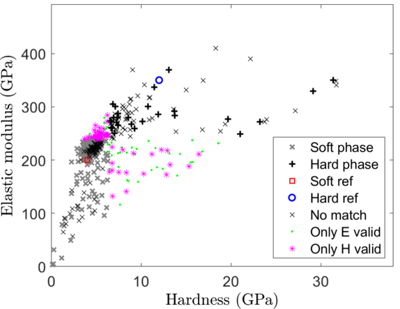

Image correlation
==========================

.. include:: includes.rst

Coupling statistical indentation with microscopy observations can help evaluate the micromechanical properties of materials [#Hilloulin_2018]_, [#Kalali_2023]_.
More recently, machine-learning approaches have been used to correlate structural and mechanical data, for example to characterize nanoscale multiphase metals [#Bruno_2024]_.

Loading and analyzing/comparing binary maps
############################################

First, mechanical maps generated using indentation experiments have to be loaded.
These maps are automatically binarized, applying a threshold (mean hardness and mean elastic modulus values by default).
These thresholds can be modified or optimized later by comparing phase ratio determined from the microstructural map.
Afterwards, a binarized microstructural map has to be loaded, with the same resolution as the mechanical maps (e.g. 25x25 pixels in the following examples).
A way to reduce pixelation is to apply linear interpolation to the mechanical maps, thereby increasing their resolution.

To create a pixelated microstructural map, use software such as ImageJ (or Fiji) [#ImageJ_software]_.
Once an image of the indentation grid is obtained by microscopy with enough quality 
(good contrast between phases, enough resolution...), load it in the image analysis software.
Crop the image around the indentation grid, leaving as little space as possible around the matrix of imprints.
Adjust the contrast/brightness of the image to emphasize the different phases in your sample.
Then adjust the number of pixels horizontally and vertically before saving the image as a .png microstructural map.

Examples of microstructural maps:
`data_image <https://github.com/DavidMercier/TriDiMap/tree/master/data_image>`_.
The ``MTS_example1_25x25`` subfolder contains the images paired with the
`MTS_example1_25x25.xls <https://github.com/DavidMercier/TriDiMap/blob/master/data_indentation/MTS_example1_25x25.xls>`_
dataset. For related background on nickel-matrix composite characterization,
see [#Mercier_2017]_ and [#Mercier1_2018]_.

Load the MTS workbook as the mechanical-property map, then load
``data_image/MTS_example1_25x25/MatrixBefore_bin_25x25.png`` as the
microstructural map. This image has the same 25x25 resolution as the workbook.
``MatrixBefore_raw.png`` is the unpixelated source image;
``MatrixBefore_bin_97x97.png`` is for maps interpolated to 97x97. The other
files in the folder are alternate processed images.

.. note::
    It is much better to obtain the microstructural image before the indentation experiments. Otherwise, residual indents affect the image quality and thus some additional operations of cleaning are required (e.g. despeckle, FFT, ...).
	

   
   *Example of image processing of the microstructural map*   

   
   *Visualization of binarized mechanical maps*
   

   
   *Comparison between binarized microstructural map and mechanical maps*
   

   
   *Phase ratio optimized comparison between binarized microstructural map and mechanical maps*

Multi-phase comparison (3 or 4 phases)
######################################

In the **BINARIZATION** GUI, **K** is the number of phases. Choose **2** for
the existing binary workflow, or **3** or **4** for multi-phase comparison.
The SEM image must be cropped and pixelated to the indentation grid. TriDiMap
converts it to grayscale, normalizes the intensity range, and uses multilevel
Otsu thresholding to assign K SEM phases. The GUI displays the resulting
labels and phase fractions.

E and H thresholds are then selected so their phase fractions follow the SEM
fractions, preferring cuts at low-density valleys in each property histogram.
For K=2, enter one cutoff per property; for K=3 or 4, the E and H fields show
K-1 ascending cutoffs; edit them as needed. The comparison panels show
E-vs-SEM agreement, H-vs-SEM agreement, and E/H phase-label agreement. The
Command Window reports the E-vs-SEM confusion matrix and per-phase recall and
intersection-over-union (IoU), followed by a table with the SEM, E and H
fractions and the mean ± standard deviation of E and H for every phase
(including intermediate phases). In the GUI, the fraction and mean fields show
phase 1 (lowest) and phase K (highest). If a property map cannot approach the SEM
fractions within five percentage points, TriDiMap issues a warning rather
than implying an exact phase match.

Otsu segmentation uses grayscale intensity, not chemical identity. Similar
contrast between phases, topography, charging, or artifacts can produce
ambiguous labels; visually verify the SEM segmentation and adjust thresholds
before interpreting the match.

A synthetic 3-phase example (matrix with two particle types) is provided:

- ``data_indentation/Synthetic_3phases_25x25.xlsx``: E and H values in the
  *other* file format (``AvgModulus`` and ``AvgHardness`` columns);
- ``data_indentation/Synthetic_3phases_25x25.csv``: X, Y, E, H and true phase
  of each indent;
- `data_image/Synthetic_3phases_25x25 <https://github.com/DavidMercier/TriDiMap/tree/master/data_image/Synthetic_3phases_25x25>`_:
  SEM-like raw image (``SEM_raw_250x250.png``), the image pixelated to the
  indentation grid (``SEM_pixelated_25x25.png``) and the generator script
  ``make_synthetic_3phases.m``.

In the **BINARIZATION** GUI, select the *other* file type with 25 x 25 indents,
load the spreadsheet and ``SEM_pixelated_25x25.png``, then set **K** to 3.
   
Image Correlation Based Targeted Indentation (ICBTI)
######################################################

Phase fractions and mechanical property values can be extracted from grid nanoindentation experiments
using innovative and quantitative statistical treatments of datasets,
with image correlation based targeted indentation (ICBTI) analysis.
The concept of the ICBTI is explained in different papers [#Mercier_2017]_, [#Mercier1_2018]_ and [#Mercier2_2018]_.

The microstructural map thresholding is based on greyscale distribution of the micrograph,
while for the mechanical property maps thresholding is based on the phase distribution.
For mechanical property maps, threshold values are obtained by finding the intermediate value between the matrix and particle peaks,
while respecting phase ratios obtained from microscopical image analysis.
After thresholding and binarization operations,
the difference between binarized mechanical property and microstructural maps is computed and plotted so as to create correlation maps.
This procedure is described graphically in the following figures.
Mechanical property–microstructure correlation maps allow assessing the match between indents
and the probed phase in order to select indents representative for each single phase.
Then, the intersection between these two mechanical properties–microstructure
correlation maps gives a new correlation map without measurements artefacts.
Such abnormal measurements may result from a defect (void, crack, surface contamination, etc.)
or from the detection of an underlying or very small particle.

Cleaned E-H plots are generated by clicking on the button 'E vs H' at the bottom left of the GUI.
Correlation maps are obtained by clicking on the button 'Corr. Map' at the bottom left of the GUI.
These auxiliary plots and threshold-sweep plots close when returning to the
mapping GUI. Other MATLAB figures are not affected.

For the cleaned E-H plot, it is asked to add material reference (bulk, homogeneous, monophasic, ...),
in order to compare experimental data with reference data.

   
   *Principle of the ICBTI analysis, for a Ni-SiC sample*
   

   
   *Principle of the ICBTI analysis, for a steel with carbides (flower) sample*
   

   
   *Scheme of different indentation tests (cross-sectional view) and mathematical criteria for discriminating between valid measurements and artefacts during ICBTI correlation analysis*
   

   
   *Cleaned E-H plot*
   
References
############################################

.. [#Bruno_2024] `Bruno F. et al., "A novel machine learning method to exploit EBSD and nanoindentation for TRIP steels microstructures analysis" (2024). <https://doi.org/10.1016/j.matdes.2024.112774>`_
.. [#Hilloulin_2018] `Hillouin B. et al., "Coupling statistical indentation and microscopy to evaluate micromechanical properties of materials: Application to viscoelastic behavior of irradiated mortars" (2018). <https://dx.doi.org/10.1016/j.cemconcomp.2018.09.008>`_
.. [#Kalali_2023] `Kalali D.G. et al., "High speed nanoindentation aided correlative study between local mechanical properties and chemical segregation in equiatomic MoNb and MoNbTi alloys" (2023). <https://link.springer.com/article/10.1557/s43578-023-01007-8>`_
.. [#ImageJ_software] `ImageJ <https://imagej.nih.gov/ij/>`_
.. [#Mercier_2017] `Mercier D. et al., "Mechanical characterization by nanoindentation of an electroplated nickel matrix composite coating" (2017). <https://dx.doi.org/10.1051/mattech/2017014>`_
.. [#Mercier1_2018] `Mercier D. et al., "Microstructural and mechanical characterization of electroplated nickel matrix composite coatings" (2018). <https://doi.org/10.1080/02670844.2018.1433270>`_
.. [#Mercier2_2018] `Mercier D. et al., "Mechanical properties mapping of cast bimetallic work roll shell material by nanoindentation" (2018). <https://doi.org/10.13140/RG.2.2.35449.16482/1>`_
