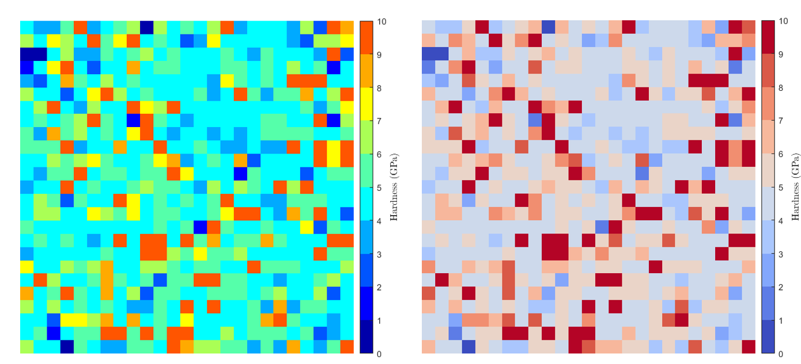
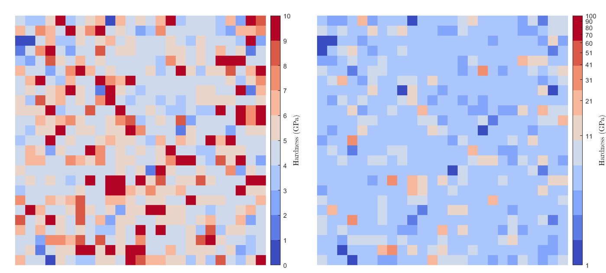
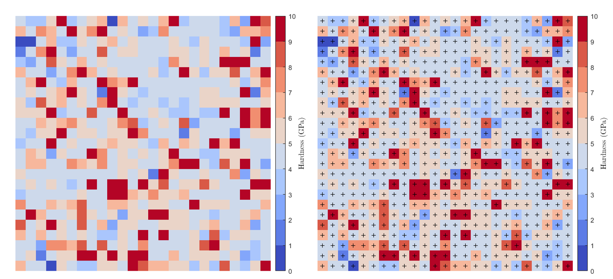

Mapping options
==========================

.. include:: includes.rst

Recalculate maps using a contact model
-------------------------------------

After loading a 2D indentation map, select **Contact model > Recalculate maps...**
and choose sink-in (Oliver and Pharr) or pile-up (Loubet) for the entire map.
The choice is made by the user; the toolbox does not infer rheology from the
existing modulus and hardness values. Use measurements from the same load/depth
point for each indent, corrected for frame compliance.

For MTS workbooks such as the bundled 25x25 example, select the original workbook.
The first sheet must contain ``Test`` IDs and matching ``Avg Modulus [a-b nm]``
and ``Avg Hardness [a-b nm]`` columns. The importer reads the corresponding
``Test ...`` curve sheets in Results order, including zero-padded and tagged
test names. It uses loading data up to the first maximum depth, within the
summary's averaging interval (75-85 nm for the bundled example). Curve columns
must be ``Displacement Into Surface`` (nm), ``Load On Sample`` (mN), and
``Harmonic Contact Stiffness`` (N/m). Stiffness is converted to mN/nm.
Properties are recalculated at each selected point and then averaged per indent;
the model is not applied to averaged depth/load/stiffness inputs.
Indents already excluded by invalid modulus/hardness entries in Results retain
NaN values, with a warning reporting their count. Other invalid curve data
stops recalculation without changing the map.

The initial read of hundreds of test sheets can take several minutes; a
cancellable progress window is shown. Measurements are cached for subsequent
model changes while the same map and unchanged workbook remain loaded.

Alternatively, select an Excel file whose first sheet contains exactly these
three headers in the first row, followed by one numeric row per indent, in the
acquisition order of the loaded map:

=================  =========  =====================
Depth (nm)         Load (mN)  Stiffness (mN/nm)
=================  =========  =====================
100                1          0.05
=================  =========  =====================

The row count and ordering must match the loaded map; no positions are matched
automatically. The same grid ordering as the original import is applied.
All measurements and resulting contact depths and areas must be finite and
positive; an invalid spreadsheet or calculation is rejected.
An input containing only modulus/hardness, without the per-test measurements,
is not sufficient for this step.
On current MATLAB releases, recalculation uses ``readcell`` rather than the
legacy ``xlsread`` reader, including in MATLAB Online.

Enter the calibrated area coefficients for the indenter, in order C0 to C8,
separated by commas. With contact depth in nm the area in nm² is
``C0*hc^2 + C1*hc + C2*hc^(1/2) + ... + C8*hc^(1/128)``.
The default ``24.56`` describes an ideal Berkovich tip, not a measured
calibration. The other defaults are epsilon = 0.75, alpha = 1.2, tip defect
= 0 nm, and beta = 1.034; use values appropriate to the experiment.
Oliver and Pharr use ``hc = h - epsilon*P/S``; Loubet uses
``hc = alpha*(h - P/S + tip defect)``. Hardness is ``P/A`` and the
**reduced indentation modulus** is ``sqrt(pi/A)*S/(2*beta)``. The latter is
not the sample Young's modulus: it has not been corrected for indenter
compliance or sample Poisson's ratio. See the `contact models and modulus
equations <https://nims.readthedocs.io/en/latest/models.html>`_.

The recalculated values are displayed in GPa and used by the mapping and
statistical views until **Contact model > Restore imported values** is selected
or another map is loaded. The property-unit selector is locked while these
values are active. An exported spreadsheet records the reduced modulus in its
unit row; retain that information when reimporting, because imported columns
are treated as ordinary modulus values. Depth slices and cross-sectional maps
use separate data and are not recalculated by this option.

Irregular XY coordinates
-----------------------

Select **Irregular XY** in the instrument/file-format selector, then **Select
file**. CSV and Excel files are supported. The first worksheet (or CSV) must
contain these four headers followed by one numeric row per indent:

``X (um), Y (um), Modulus (GPa), Hardness (GPa)``

Coordinates are in micrometres and properties in GPa. Negative coordinates are
allowed; coordinate pairs must be finite and unique. Missing property values
may be NaN, but each property must contain at least one finite measurement.
``Reduced modulus (GPa)`` is also accepted instead of ``Modulus (GPa)`` and
retains the reduced-modulus label.
Try the synthetic example ``data_indentation/irregular_example.csv``.

Property maps show colored points at the recorded XY positions, without
reshaping, serpentine flipping, filling missing measurements, or interpolating
across voids. E-H plots, distributions and contact-model recalculation use the
original measurements, not resampled grid cells. Contact-model input must still
contain one measurement row per indent in acquisition order.

Grid-only operations (pixel interpolation/smoothing, index cropping, spatial
phase maps, error maps, 3D slices and image binarization) are disabled in this
mode. Grid dimensions and spacing are not used; units are locked to the input
format. **Get property value** reports the nearest measured position and its
displayed value. The **XLS** button exports an ``_XY.csv`` file preserving the
coordinates and current original/recalculated properties in GPa, not display
normalization or thresholding; this file can be reimported with Irregular XY.
To return to a regular map, select its original file format, set its grid
dimensions if necessary, and import the file normally.

Crop
---------------------------

Maps can be cropped to remove unnecessary areas (e.g., bakelite around the specimen or an oxidized or contaminated surface)
or to avoid measurement artefacts (e.g., surface effects, roughness, or surface slope).
This option is especially useful for cleaning a dataset before further statistical analysis.
After cropping, it is possible to create a new .xls file (with cropped dataset), by pressing the 'XLS' button at the bottom of the GUI.

Colormap
---------------------------

It is possible to set different colormap for the mapping into the GUI.
The default 'Jet' colormap in |matlab| [#Matlab]_ is not a diverging colormap and can obscure patterns.
Many authors have recommended using diverging colormaps instead of the default |matlab| colormaps [#Eddins]_, [#Moreland]_, [#MyCarta]_.

The |matlab| function used to generate a divergent colormap is:
`diverging_map.m <https://github.com/DavidMercier/TriDiMap/blob/master/third_party_codes/colormapFunctions/diverging_map.m>`_

The colormap can be flipped for aesthetic reasons.

For publication, select **Grayscale (all plots)** in the **Colormap** list.
The shared list is at the top of the lower left-hand options panel. It follows
the selected view and stays available for maps (including KAMM), E-H plots and PDFs.
This converts the
displayed colormap, E-H sector/cluster points and envelopes, and PDF
(probability density) bars, fitted components and annotations to grayscale.
It also applies to the pixelized phase map selected with **Plot map with
sectors**. The different phase colors become different gray levels; phase
assignments, thresholds, measurements and fitted results are unchanged.

Unlike the scalar ``gray`` palette, this also converts explicitly colored
curves, bars and phase symbols. It replaces the former toolbar/menu option.

The option is off by default. Selecting it only changes the current rendering,
without rerunning clustering or PDF fitting. It remains enabled for subsequent
plots and saved plots; choose another colormap to restore the original colors.

   
   *Maps with a non-diverging colormap (left) and a diverging colormap (right)*

Colorbar
---------------------------

The limits (minimum and maximum) and the number of steps of the colorbar can be defined automatically or can be set by hand.
A logarithmic colorbar can be applied to emphasize gradient on a map when there is a large difference in term of mechanical property values between 2 phases.

   
   *Maps without (on the left) and with (on the right) a logarithmic colorbar*
   
Markers / Grid
---------------------------

Simple grid (corresponding to a regular pattern) or markers grid showing indent positions
can be plotted on an indentation map, in order to help for `the overlay of the mechanical map onto the microstructural map <https://tridimap.readthedocs.io/en/latest/mapping.html#overlay>`_.

   
   *Maps with markers for indent positioning (right)*
   
References
-------------
.. [#Matlab] `Matlab Colormap. <https://fr.mathworks.com/help/matlab/ref/colormap.html>`_
.. [#Eddins] `Eddins S., "Divergent colormaps". <https://blogs.mathworks.com/steve/2015/01/20/divergent-colormaps/>`_
.. [#Moreland] `Moreland K., "Diverging Color Maps for Scientific Visualization". <https://www.kennethmoreland.com/color-maps/>`_
.. [#MyCarta] `MyCarta, "A good divergent color palette for Matlab". <https://mycarta.wordpress.com/2012/03/15/a-good-divergent-color-palette-for-matlab/>`_
