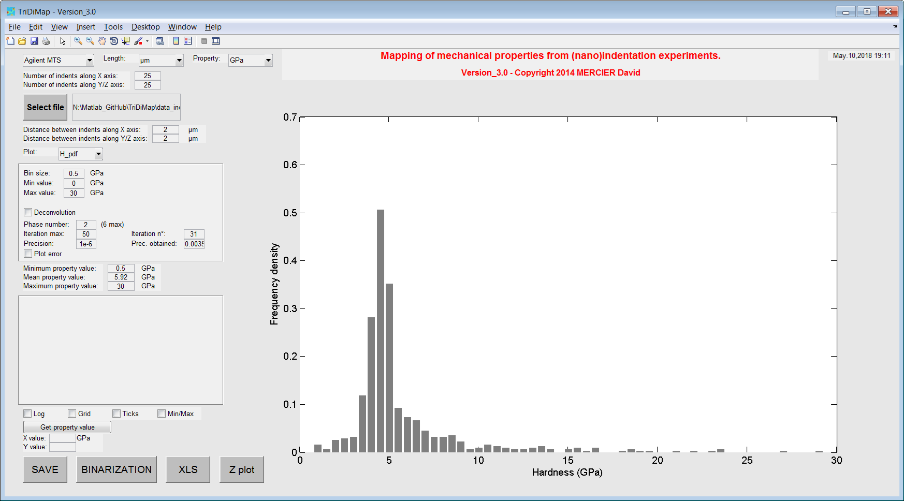
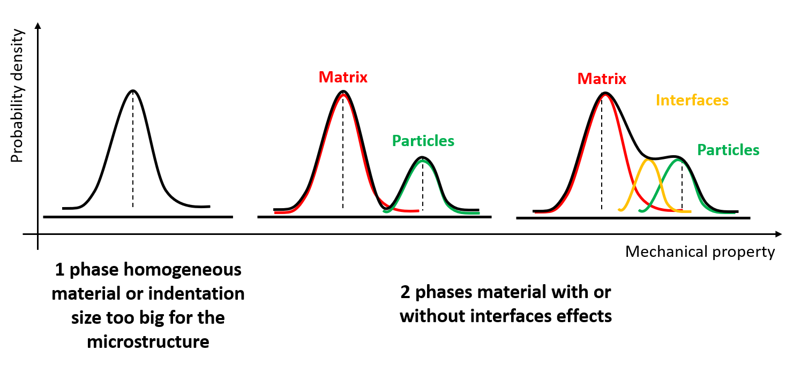
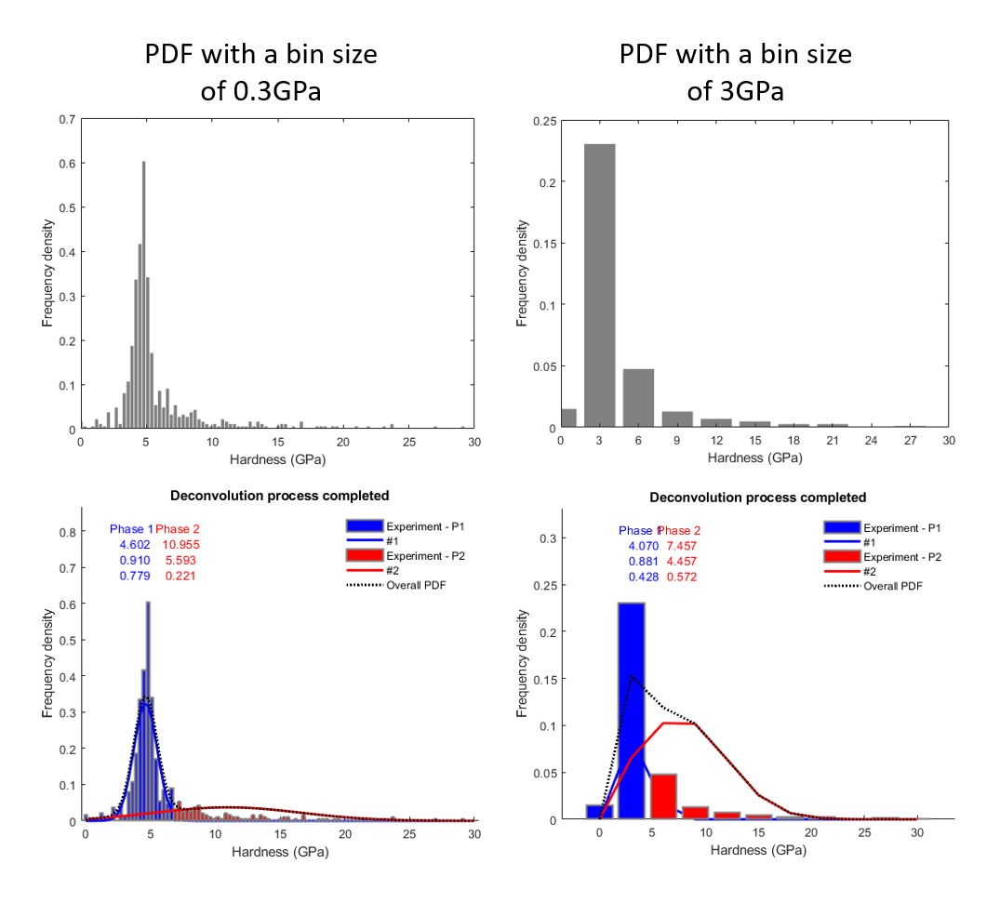
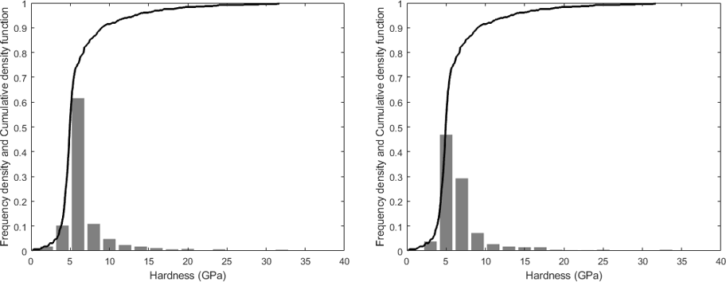
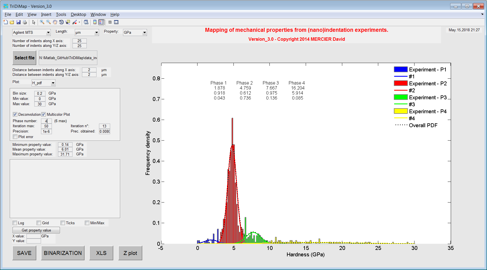
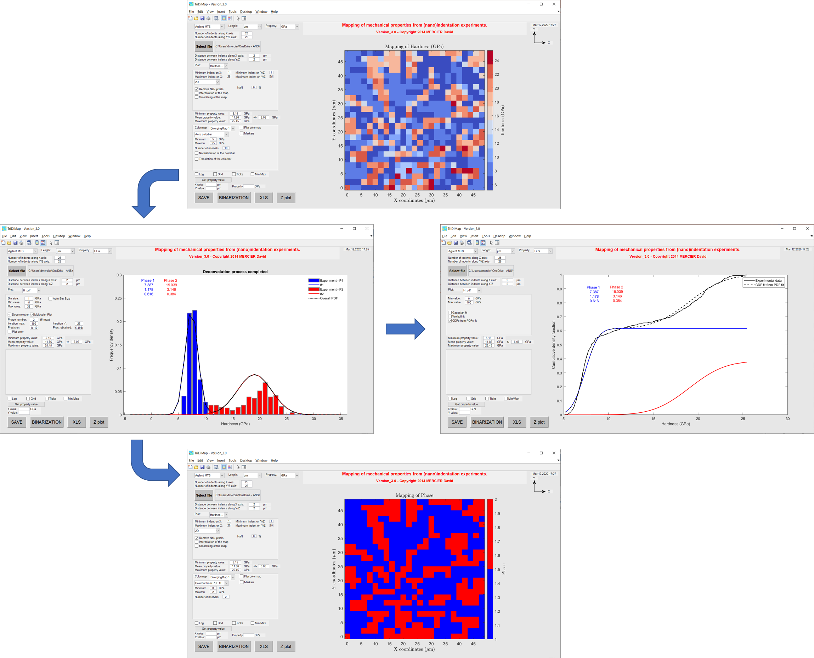
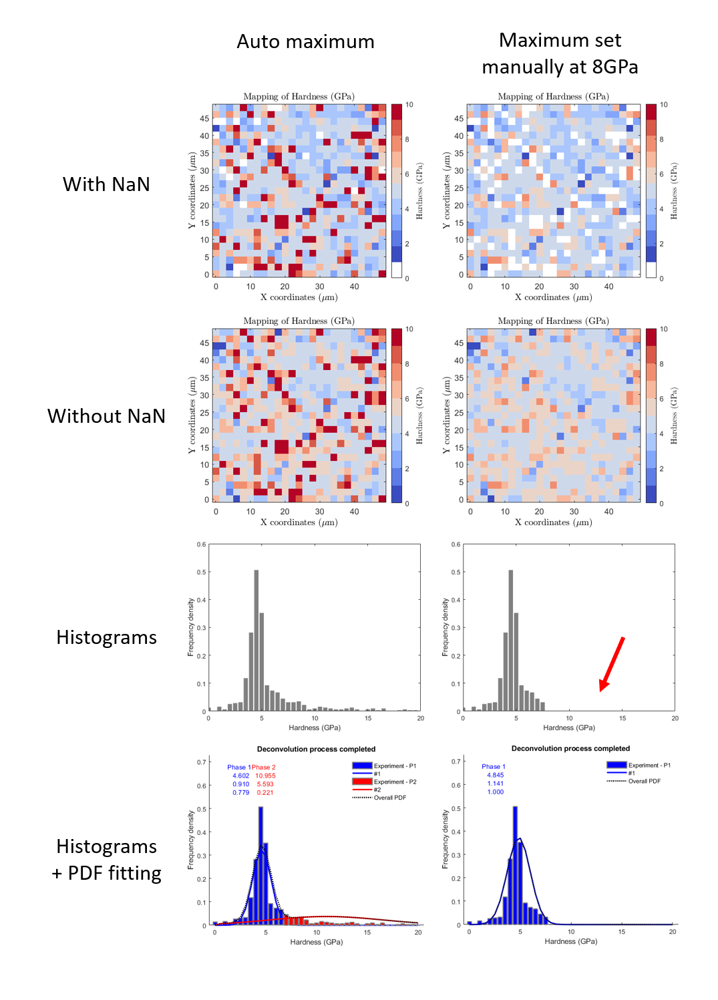
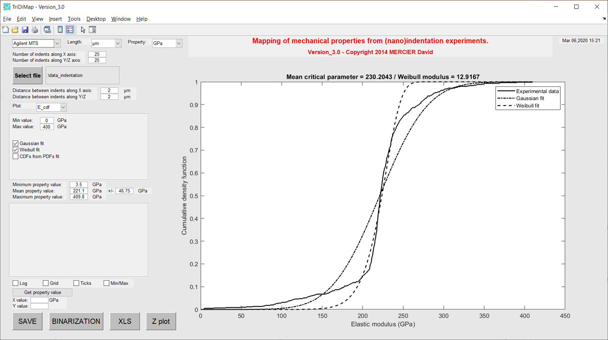
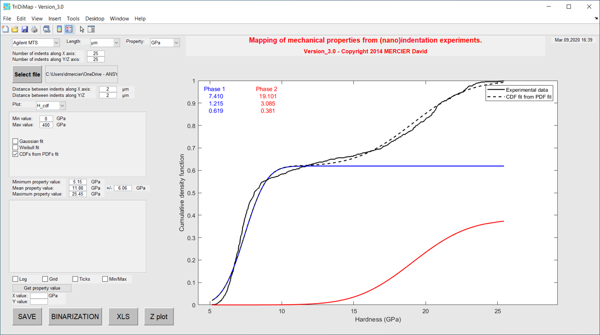

Statistical analysis
==========================

.. include:: includes.rst

For statistical nanoindentation (SNI) results [#Tuinukuafe_2022]_ or statistical analysis of mechanical-property distributions, histograms or cumulative distributions can be used. According to Tuinukuafe et al., SNI may be ineffective for measuring the mechanical properties of individual phases in a microstructure if they are not prolific enough to exhibit a continuous indent response [#Tuinukuafe_2022]_. This conclusion is directly linked to the question of indentation length scales (see https://tridimap.readthedocs.io/en/latest/mapping.html#indentation-length-scales).

Probability density function (PDF)
############################################

   
   *Histograms of hardness values*

Histograms are useful for visualization, particularly when the data follow a familiar pattern such as a bell-shaped curve.
Such a curve is known as the "normal distribution" or the "Gaussian distribution".
For a homogeneous material, only one peak is expected; for a heterogeneous material,
one peak per phase may be expected. In the latter case, intermediate peaks between phase peaks can be observed
when interfaces are not spatially negligible. The drawback of this plot is the user-dependence
of the bin size and thus of the distribution shape (i.e. peak intensity).

Indeed, the shape of the distributions depends on bin size, which is set arbitrarily by the user (e.g., 0.5 GPa or 3 GPa).
This issue is well known in the literature and is a little bit discussed in this presentation [#Mercier_2016]_ and this paper [#Hrbek_2017]_.
The shape of the distributions is also bin step dependent.
In other words, the distribution changes depending on whether the histogram starts at an odd or an even value.

For **E_PDF** and **H_PDF**, the frequency-density axis starts at zero and
automatically ends 10% above the largest displayed histogram value.
With deconvolution enabled, the limit also includes the displayed phase
curves and overall fitted PDF, so narrow peaks are not clipped above one.
Limits follow each improved displayed fit, not rejected fitting candidates.
This only changes the vertical display range, not histogram normalization
or fitted values. If the selected histogram range contains no positive
values, the plot uses an empty 0-to-1 range and warns to check the range
and bin size. CDF and relative-error axis scaling are unchanged.

**Plot error** uses the overall deconvolved PDF cached for the selected
E/H property. If the fit is missing or the data, histogram range or bin
size have changed, the option is cleared and a message requests a new
deconvolution; the measured histogram remains visible. Errors are plotted
at the histogram's property coordinates. Empty bins have undefined
relative error and are omitted with a warning.

   
   *Example of different fitted histogram distribution schematized as a function of the specimen*
   

   
   *Effect of the bin size definition on the distribution shape*
   

   
   *Effect of the bin step on the distribution shape: the histogram starts at 0 GPa on the left and at 1 GPa on the right, using the same bin size of 2 GPa.*

The next step is to fit this distribution using a probability density function.
Such mathematical approach is very well defined in the literature [#Nemecek_2009]_, [#Nemecek_2013]_ and [#Hausild_2016]_.
Note that the results obtained after deconvolution (average values and standard deviations for each peak) depend on the
bin size. A way to avoid user selection of the bin size is to use the Freedman–Diaconis rule of thumb, which estimates
the bin size after calculating the interquartile range (IQR) of the data [#FreedmanDaconis_1981]_.
To activate this option, check the box for 'Auto Bin Size' on the GUI.

   .. math::
      :label: binSizeAuto

      \mathrm{Bin\ Size} = \frac{2*IQR}{n^{\frac{1}{3}}}

Here, :math:`n` is the number of observations in the sample.

The |matlab| function used to calculate the interquartile range of the data is:
`iqrVal.m <https://github.com/DavidMercier/TriDiMap/blob/master/matlab_code/util/iqrVal.m>`_

Another rule of thumb is to use between 6 and 20 bins in a histogram.

The |matlab| function used to plot the distribution of mechanical property values using histogram is:
`pdfGaussian.m <https://github.com/DavidMercier/TriDiMap/blob/master/matlab_code/util/pdfGaussian.m>`_

The |matlab| function used to fit using a probability density function and to process the deconvolution is:
`TriDiMap_runDeconvolution.m <https://github.com/DavidMercier/TriDiMap/blob/master/matlab_code/module_mapping/TriDiMap_runDeconvolution.m>`_

This last function has been extensively inspired by the work of Němeček J. et al. [#Nemecek_2010_1]_, [#Nemecek_2010_2]_ and [#Nemecek_2010_3]_.

An example of fitting and deconvolution process is given in the following figure, 
followed by another example of decomposition process leading to phase mapping and plot of corresponding cumulative distributions. 
   

   
   *Histograms of hardness values with Gaussian PDF after fitting and deconvolution step*
   

   
   *Phase map and cumulative distributions of each phase resulting from decomposition step*

.. note::
   Effect of the interphase can be considered and could be implemented in this toolbox [#Cech_2017]_.
   
.. note::
   The choice of the bin size could be defined as an automatic calculation, based on the number of phases, the number of data and the minimum of peak intensity...

When data are noisy due to experimental artefacts (e.g. surface contamination, interfaces effect or interesting phase inside the sample...) for example,
with very high or very low mechanical property values, it is always possible to cut the signal, by setting manually (on the GUI) the extrema.
This operation can be seen as an arbitrary cleaning, but careful with a fitting process,
which gives different mean values, given peak shapes or peak number modification.

   
   *Example of manually saturated indentation data, with a comparison between automatic maximum and a maximum set to 8GPa*

.. note::
   Sometimes the fit does not converge, just restart the fitting process... or change a little bit the bin size.
   
Cumulative density function (CDF)
############################################

Gaussian and Weibull CDF fitting initializes its numerical configuration
when the launcher starts. With Optimization Toolbox, the defaults are
``TolFun_value=1e-6``, ``TolX_value=1e-6`` and ``MaxIter_value=400``.
The Gaussian mean is unbounded by default; the Weibull shape has bounds
``eps`` to ``Inf``. The existing scale/standard-deviation bounds remain
zero to the maximum fitted property value.

These settings are stored in ``gui.config.numerics``. Already-open or
restored sessions with missing settings initialize them when fitting starts,
with an explicit warning; existing custom values are preserved.
Without Optimization Toolbox, the existing base-MATLAB ``fminsearch``
path is unchanged. Weibull fitting can be selected without first fitting
a Gaussian.

Combined PDF+CDF views
+++++++++++++++++++++

In **E_PDF+CDF** and **H_PDF+CDF**, the **left y-axis** remains the PDF
frequency-density axis, including its data-adaptive limits. The **right
y-axis** displays the experimental CDF and any selected CDF fits on a
linear probability scale from **0 to 1**. Both sides share the property
x-axis and histogram range, without rescaling either dataset.

Enable **CDF fit from PDF fit** to use the cached PDF deconvolution for
the same property. A new deconvolution performed directly in a combined
view also populates that property's PDF cache. Missing fits produce an
explicit message rather than a placeholder curve. Switching back to a
standalone PDF, CDF or map view removes the secondary axis. Figure saving
and grayscale use the same axes object for both sides.

Combined views use a single legend outside the plot on the right.
Each phase is listed once with its mean, standard deviation (SD) and
fraction (f), rather than drawing overlapping PDF and CDF phase summaries
inside the axes. Phase colors still identify the corresponding PDF/CDF
curves. Experimental distributions, overall fits and any selected
Gaussian/Weibull CDF curves remain identified. Standalone PDF/CDF
annotations are unchanged.

Separate y-axes use MATLAB's ``yyaxis`` and require **R2016a or newer**.
The availability check accepts ordinary MATLAB files, MEX files and
protected P-code implementations, as well as built-in functions.
Older releases can use the separate PDF and CDF views instead.

The cumulative distribution of a mechanical property avoids the bin-size dependency of a histogram.
But, it is much more difficult to decompose and in this toolbox, only Gaussian and Weibull fitting are proposed,
which is mainly useful for a homogeneous material. The Weibull function is from the PopIn toolbox [#popin]_.

The |matlab| function used to plot the cumulative distribution of mechanical property values is:
`cdfGaussian.m <https://github.com/DavidMercier/TriDiMap/blob/master/matlab_code/util/cdfGaussian.m>`_

The |matlab| function used to fit the cumulative distribution with a Weibull function is:
`TriDiMap_Weibull_cdf.m <https://github.com/DavidMercier/TriDiMap/blob/master/matlab_code/module_mapping/TriDiMap_Weibull_cdf.m>`_
 

   
   *Cumulative distribution of elastic modulus values with Gaussian and Weibull fitting*
   

   
   *Cumulative distribution of elastic modulus values with cumulative distributions for each different phase*  
   
References
############################################

.. [#Cech_2017] `Čech J.et al., "Approche statistique pour identifier les propriétés mécaniques des phases individuelles à partir de données d’indentation" (2017). <https://doi.org/10.1051/mattech/2016041>`_
.. [#FreedmanDaconis_1981] `Freedman D. and Daconis P., "On the histogram as a density estimator:L2 theory" (1981). <https://doi.org/10.1007/BF01025868>`_
.. [#Hausild_2016] `Haušild P. et al., "Determination of the individual phase properties from the measured grid indentation data" (2016). <https://doi.org/10.1557/jmr.2016.375>`_
.. [#Hrbek_2017] `Hrbek V. and Koudelková V., "Grid Indentation and Statistic Deconvolution: Limitations and Accuracy" (2017). <https://dx.doi.org/10.4028/www.scientific.net/KEM.731.15>`_
.. [#Mercier_2016] `Mercier D. et al., "Combined techniques for the characterization of an electrodeposited Nickel coating with embedded SiC particles: from microstructure to local mechanical properties" (2016). <https://doi.org/10.13140/RG.2.2.13062.16962>`_
.. [#Nemecek_2009] `Němeček J., "Nanoindentation of heterogeneous structural materials", PhD thesis (2009). <http://ksm.fsv.cvut.cz/~nemecek/teaching/dmpo/literatura/habilitation%20thesis_Nemecek_CTU-01-2010.pdf>`_
.. [#Nemecek_2010_1] `Němeček J., "Probability density function 1.0" (2010). <http://ksm.fsv.cvut.cz/~nemecek/links/exp2pdf10/exp2pdf10.htm>`_
.. [#Nemecek_2010_2] `Němeček J., "Probability density function 2.1" (2010). <http://ksm.fsv.cvut.cz/~nemecek/links/exp2pdf21/exp2pdf21.htm>`_
.. [#Nemecek_2010_3] `Němeček J., "Deconvolution algorithm 3.0" (2010). <http://ksm.fsv.cvut.cz/~nemecek/links/decon30/decon.htm>`_
.. [#Nemecek_2013] `Němeček J. et al., "Micromechanical analysis of heterogeneous structural materials" (2013). <https://doi.org/10.1016/j.cemconcomp.2012.06.015>`_
.. [#popin] `Mercier D.et al., "PopIn documentation". <https://popin.readthedocs.io/en/latest/models.html#weibull-type-distribution>`_
.. [#Tuinukuafe_2022] `Tuinukuafe A.et al., "On the Role of Continuity in Statistical Nanoindentation of Composite Microstructures". <https://doi.org/10.1111/jace.18665>`_
